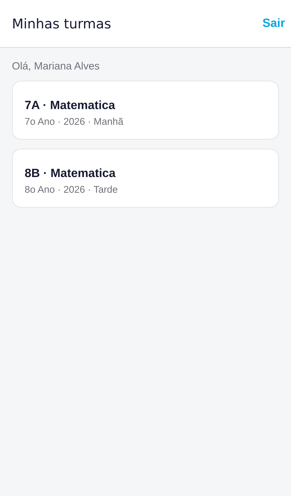
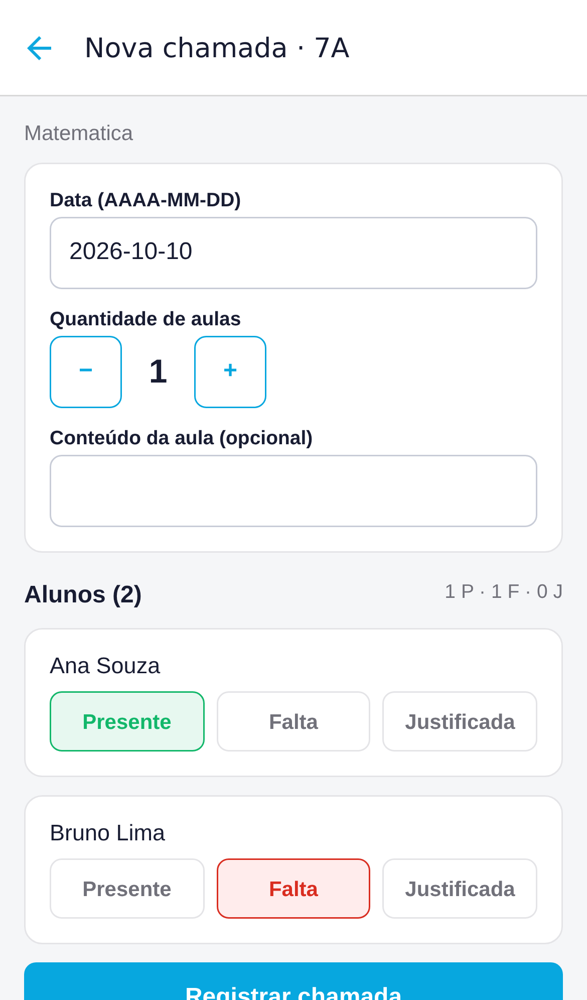

# Professor PWR — App Mobile

App para o professor fazer chamada e lançar notas pelo celular. Ele usa a mesma API do sistema web
(`api-syst-teacher`), então tudo o que é registrado no app aparece no web e vice-versa.

Feito com **React Native + Expo SDK 57** e **Expo Router**, em TypeScript.

<p align="center">
  
  
  
  
</p>

## Funcionalidades

- **Login** com email e senha. A sessão fica no armazenamento seguro do aparelho (SecureStore) e é renovada
  automaticamente: o professor não precisa entrar de novo a cada abertura do app.
- **Minhas turmas:** as turmas e disciplinas atribuídas ao professor logado.
- **Chamada:**
  - Uma chamada nova começa com todos presentes; basta tocar em **Falta** ou **Justificada**.
  - Dá para escolher a data e a quantidade de aulas e anotar o conteúdo.
  - Chamadas já registradas podem ser abertas e corrigidas.
- **Nova avaliação:** na aba Avaliações da turma. Regular ou recuperação, com data de entrega (define o
  bimestre), nota máxima, peso e status inicial. A turma e a disciplina vêm da tela da turma.
- **Lançar notas:**
  - Aceita vírgula (`8,5`) e não deixa salvar nota acima da nota máxima.
  - Só permite editar avaliações **Em andamento**; as demais abrem só para leitura.
- **Alunos:** lista de alunos da turma.
- **Painel:** indicadores do bimestre, situação dos alunos, frequência, ranking, notas das avaliações e boletim.

Os cadastros (turmas, alunos, professores e calendário), a edição e exclusão de avaliações e a mudança de status
(iniciar, concluir, reabrir) continuam no sistema web.

## Pré-requisitos

- **Node.js** 20 ou mais recente.
- A **API** rodando, com um professor que tenha senha. O seed da API cria o admin `admin@admin.com` (senha
  `admin123`) e a professora `delvangela@gmail.com` (senha `123`). Para definir a senha de um usuário existente,
  rode na API: `npm run user:set-password -- <email> <senha>`.
- O app **Expo Go** no celular ([Android](https://play.google.com/store/apps/details?id=host.exp.exponent) ·
  [iOS](https://apps.apple.com/app/expo-go/id982107779)), ou um emulador Android ou simulador iOS.

## Como rodar

```bash
npm install
cp .env.example .env.local
```

Edite `.env.local` e aponte `EXPO_PUBLIC_API_URL` para a API:

| Onde o app roda | `EXPO_PUBLIC_API_URL` |
| --- | --- |
| Celular físico (Expo Go) | `http://<IP-do-computador>:3000/api`, ex.: `http://192.168.1.35:3000/api` |
| Emulador Android | `http://10.0.2.2:3000/api` |
| Simulador iOS ou navegador | `http://localhost:3000/api` |

> `localhost` não funciona no celular: ele aponta para o próprio aparelho. Para descobrir o IP do computador,
> use `ip addr` (Linux), `ipconfig` (Windows) ou `ipconfig getifaddr en0` (macOS).

Depois, inicie o app:

```bash
npx expo start
```

Leia o QR code com o Expo Go (Android) ou com a câmera (iOS). O celular e o computador precisam estar na mesma rede Wi-Fi.

## Scripts

| Comando | O que faz |
| --- | --- |
| `npx expo start` | Inicia o servidor de desenvolvimento |
| `npx expo start --web` | Abre o app no navegador |
| `npm run typecheck` | Checa os tipos com TypeScript |
| `npm run lint` | Roda o ESLint (inclui as regras de dependência entre camadas) |
| `npm test` | Roda os testes (Jest + React Native Testing Library) |

## Arquitetura

Clean Architecture organizada **por feature**. Cada feature tem as mesmas três camadas, e a dependência sempre
aponta para o domínio:

```
presentation  ──►  domain  ◄──  data
(telas, hooks)     (regras)     (HTTP, DTOs)
```

- **domain**: modelos, regras puras e use cases. Não importa React, Expo, React Query nem `fetch`, o que deixa as
  regras testáveis sem renderizar nada. Os repositórios são interfaces declaradas aqui.
- **data**: implementa os repositórios com HTTP. Os DTOs da API e os mappers ficam aqui, então mudanças no
  formato da API não vazam para as telas.
- **presentation**: telas, componentes e hooks. Os dados vêm do React Query, que chama os repositórios.

Use case só existe onde há regra (salvar chamada, salvar notas, login, restaurar sessão). Leituras simples vão do
hook direto ao repositório.

O ESLint impede quebras dessas regras: `domain` não pode importar framework, `data`, `presentation` ou `main`;
`data` não pode importar `presentation`; `core` e `shared` não podem importar features.

### Pastas

```
src/
  app/            rotas do Expo Router; cada arquivo só re-exporta a tela da feature
  main/           composição: container (injeção de dependência), providers, React Query, variáveis de ambiente
  core/           base sem regra de negócio: erros, paginação, cliente HTTP, sessão (SecureStore / localStorage)
  shared/         reaproveitável entre features: ui/ (um componente por pasta), theme, format, navigation
  features/
    auth/         login, sessão, menu lateral
    classes/      minhas turmas e tela da turma (abas)
    lessons/      chamadas
    assessments/  avaliações e notas
    students/     alunos da turma
    dashboard/    painel
  test/           utilitários de teste (providers com dependências falsas, mocks)
```

Dentro de cada feature:

```
features/lessons/
  domain/         models.ts, rules.ts, LessonRepository.ts, usecases/
  data/           dto.ts, mappers.ts, HttpLessonRepository.ts
  presentation/   queryKeys.ts, labels.ts, hooks/, components/<Componente>/, screens/<Tela>/
  index.ts        API pública da feature (outras features e as rotas importam só daqui)
```

Cada componente e cada tela tem a própria pasta, com o componente, o `styles.ts` (`StyleSheet.create`) e um
`index.ts`.

### Como adicionar uma feature

1. Crie `src/features/<nome>/` com `domain/`, `data/` e `presentation/`, copiando o esqueleto de uma feature
   existente.
2. Declare a interface do repositório em `domain/` e a implementação HTTP em `data/`.
3. Registre o repositório em `src/main/di/types.ts` e em `src/main/container.ts`.
4. Exponha as telas no `index.ts` da feature e crie a rota em `src/app/` re-exportando a tela.
5. Escreva os testes das regras e dos use cases ao lado dos arquivos (`*.test.ts`).

### Desempenho

- **Menos requisições:** o React Query guarda as respostas em cache por recurso (turmas e alunos por 5 min,
  chamadas e avaliações por 1 min). Ao salvar, só as listas afetadas são recarregadas. Erros 4xx não são repetidos
  e as falhas de rede têm até 2 novas tentativas, com espera crescente.
- **Paginação:** chamadas e alunos carregam 30 por vez, e a próxima página vem ao chegar no fim da lista.
- **Listas virtualizadas:** as listas de leitura usam `FlashList`. Os formulários de chamada e notas usam
  `FlatList`, porque campos de texto não convivem bem com a reciclagem de células do `FlashList`.
- **Menos re-render:** linhas memoizadas e estado do formulário por aluno. Marcar a presença de um aluno redesenha
  só a linha dele.
- **Requisições canceladas** ao sair da tela (`AbortSignal`).

## Como funciona o login

1. `POST /api/auth/login` devolve um **access token** (JWT, 15 min) e um **refresh token** (30 dias).
2. Toda requisição envia `Authorization: Bearer <access token>`.
3. Quando a API responde 401, o app troca o refresh token por um novo par (`POST /api/auth/refresh`) e repete a
   requisição. Se várias requisições falharem ao mesmo tempo, a troca é feita uma vez só.
4. Se o refresh também falhar, a sessão é apagada e o app volta para o login.
5. **Sair** chama `POST /api/auth/logout`, que invalida o refresh token no servidor.

## Problemas comuns

| Sintoma | Causa provável |
| --- | --- |
| "Sem conexão com o servidor" no celular | `EXPO_PUBLIC_API_URL` usa `localhost`, o IP está errado, a API está parada ou o firewall bloqueia a porta 3000 |
| Mudei o `.env.local` e nada mudou | Reinicie o `npx expo start` e recarregue o app |
| Login recusado com a senha certa | O professor está sem senha ou inativo; defina com `npm run user:set-password` na API |
| Erro de CORS no navegador | Inclua a origem do Expo Web (ex.: `http://localhost:8081`) em `CORS_ORIGINS` na API. O app nativo não usa CORS |
| "Notas só podem ser lançadas…" | A avaliação não está *Em andamento*; mude o status pelo sistema web |

## Publicação

- A API precisa estar em **HTTPS**: Android e iOS bloqueiam HTTP sem criptografia em builds de produção.
- Os builds e o envio para as lojas são feitos com o EAS: `npx eas-cli@latest build`.
  Veja a [documentação do EAS](https://docs.expo.dev/eas/).
